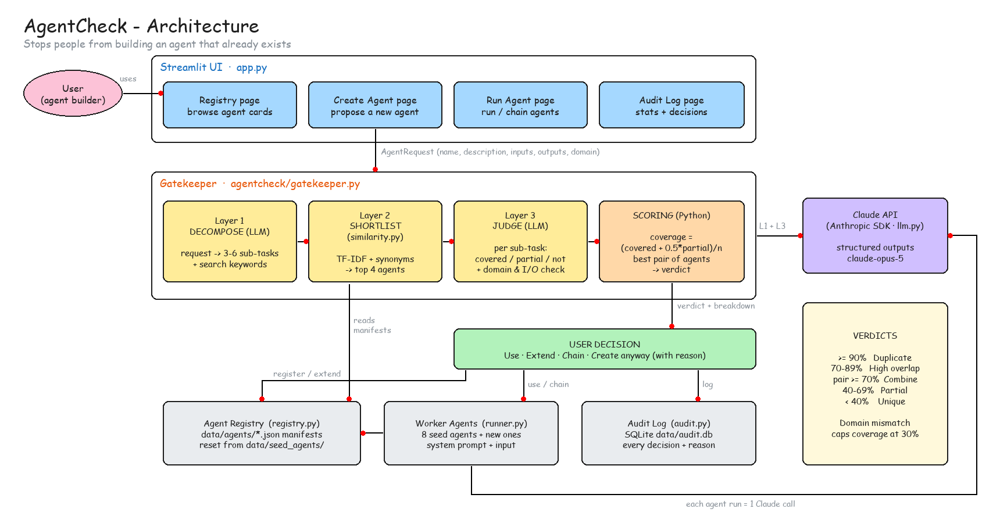

# 🛡️ AgentCheck

**Stop building AI agents that already exist.**

AgentCheck is an agent registry with a **Gatekeeper** agent in front of it. When someone proposes a
new agent, the Gatekeeper compares it with every registered agent. If an existing agent already does
the job, or most of it, the Gatekeeper says so and suggests reusing, extending or combining agents
instead of building a duplicate.

> Proposed: *"Inbox Digest Bot: gives me a daily gist of my mail"*
> Gatekeeper: 🔴 **Duplicate.** *"Email Summarizer" already does this. Use it instead?*

## Why

As teams build more AI agents, the same agent gets rebuilt under different names ("Email Summarizer",
"Inbox Digest Bot", "Mail Recap Agent"). Each copy has to be built, tested and maintained. Keyword
search can't catch these duplicates, because the names share no words. And a shared word like
"summarize" doesn't mean two agents do the same job (emails vs. clinical records).

AgentCheck compares what agents **do**, one sub-task at a time, rather than what they are called.

## Features

- **Duplicate detection by meaning.** It matches "Inbox Digest Bot" to "Email Summarizer" even though they share no keywords.
- **Coverage per sub-task.** It shows *which* parts of the new agent already exist (✅ / 🟡 / ❌), not just a single score.
- **The 80% case.** When an agent covers most of the request, you can **extend** it with the missing sub-tasks.
- **Combining agents.** It spots when two agents together cover the request, for example Translator → Sentiment Analyzer, and runs them as a chain.
- **Domain awareness.** A clinical-records request is not matched to an email agent just because both "summarize".
- **Governance.** "Create anyway" requires a written reason. Every decision is saved in an audit log.
- **Runnable agents.** All 8 seed agents work, and each comes with sample input for live demos.

## Architecture



The editable diagram is in [`docs/architecture.excalidraw`](docs/architecture.excalidraw). Open it at
[excalidraw.com](https://excalidraw.com) or with the VS Code Excalidraw extension.

### How the Gatekeeper decides

| Step | What happens | How |
|---|---|---|
| **Layer 1: Decompose** | The request is split into 3-6 atomic sub-tasks plus search keywords | Claude, structured output |
| **Layer 2: Shortlist** | Registry agents are ranked and the top 4 kept | TF-IDF + synonyms (or `sentence-transformers` if installed) |
| **Layer 3: Judge** | Each candidate × each sub-task is marked covered / partial / not covered, and domain and I/O compatibility are checked | Claude, structured output |
| **Scoring** | `coverage = (covered + 0.5 × partial) / sub-tasks`, plus the best pair of agents | Plain Python, unit-tested |

| Coverage | Verdict | Suggested action |
|---|---|---|
| ≥ 90% | 🔴 Duplicate | Use the existing agent |
| 70-89% | 🟠 High overlap | Extend it with the missing sub-tasks |
| two agents ≥ 70% together | 🟡 Partial | Chain the two agents |
| 40-69% | 🟡 Partial | Consider reusing |
| < 40% | 🟢 Unique | Register the new agent |

A domain mismatch (for example, email vs. clinical data) caps coverage at 30%.

## Tech stack

Python 3.11+ · [Streamlit](https://streamlit.io) · [Anthropic Claude API](https://docs.anthropic.com) ·
Pydantic · SQLite · pytest

## Getting started

**Prerequisites:** Python 3.11-3.13 and an [Anthropic API key](https://console.anthropic.com).

```powershell
git clone https://github.com/vaishnaviakkewar19/AgentCheck.git
cd AgentCheck

python -m venv .venv
.\.venv\Scripts\activate          # macOS/Linux: source .venv/bin/activate
pip install -r requirements.txt

copy .env.example .env            # macOS/Linux: cp .env.example .env
# edit .env and set ANTHROPIC_API_KEY

streamlit run app.py
```

The app opens at http://localhost:8501.

In VS Code, launch configurations are included: press **F5** and pick **"AgentCheck: Streamlit app"**.

## Demo scenarios

Click **🔄 Reset demo** in the sidebar, then open **➕ Create Agent** and pick a scenario from the dropdown:

| # | Scenario | Expected result |
|---|---|---|
| 1 | Exact duplicate: email thread summary | 🔴 Email Summarizer → **Use**, and it runs immediately |
| 2 | Same job, different words: "Inbox Digest Bot" | 🔴 Email Summarizer |
| 3 | **The 80% case**: invoice → SAP | 🟠 Invoice Extractor, missing "push to SAP" → **Extend** |
| 4 | Two agents together: Spanish reviews + sentiment | 🟡 Translator + Sentiment Analyzer → **Chain** |
| 5 | Looks similar but isn't: prior-auth summaries | Email Summarizer rejected (wrong domain); Clinical Note Summarizer partial |
| 6 | Truly new: Jira sprint report | 🟢 Unique → **Register** |
| 7 | Override: Outlook email summarizer | 🔴 → give a reason → **Create anyway** (logged) |
| 8 | Registry learns: sprint status summary | 🔴 matches the agent created in #6 |

Finish on **📜 Audit Log** to show duplicates prevented and estimated hours saved.

## Seed agents

| Agent | Does |
|---|---|
| Email Summarizer | Email threads → key points + action items |
| Invoice Extractor | Invoice PDF/text → structured JSON |
| Sentiment Analyzer | Text/reviews → positive / neutral / negative with reasons |
| Translator | Text → any language, tone preserved |
| Meeting Notes Generator | Transcript → summary, decisions, owners |
| SQL Query Builder | Question + schema → SQL + explanation |
| Resume Screener | Resume + job description → fit score and gaps |
| Clinical Note Summarizer | Clinical note → problems, meds, allergies, plan |

## Testing

```powershell
pytest -q                          # offline: no API key needed (LLM calls are stubbed)
python scripts/run_scenarios.py    # live: runs all 8 scenarios against the API and checks verdicts
```

## Project structure

```
app.py                        Streamlit UI (Registry, Create, Run, Audit pages)
agentcheck/
  gatekeeper.py               3 layers + scoring and verdict logic
  similarity.py               Layer 2 candidate search
  registry.py                 JSON agent manifests: list / register / extend / reset
  llm.py                      Anthropic SDK wrapper (structured outputs, error handling)
  runner.py                   runs a worker agent
  audit.py                    SQLite decision log + stats
  models.py                   Pydantic models
  scenarios.py                the 8 demo scenarios
  samples.py                  sample inputs for each seed agent (fictional)
data/seed_agents/             the 8 starting agents
docs/                         architecture diagram (.excalidraw + .png)
scripts/                      live scenario runner, diagram generator
tests/                        offline test suite
```

## Configuration

Set these in `.env`:

| Variable | Default | Notes |
|---|---|---|
| `ANTHROPIC_API_KEY` | required | |
| `CLAUDE_MODEL` | `claude-opus-5` | e.g. `claude-sonnet-5` for lower cost |
| `CLAUDE_EFFORT` | `medium` | `low` is faster, `high` is more thorough |
| `TOP_K_CANDIDATES` | `4` | how many agents the judge compares |

## Roadmap

- Periodically scan the registry for duplicates that already exist
- Suggest merging overlapping agents
- Agent versioning with rollback
- Expose registered agents over MCP
- An evaluation set of labelled request/agent pairs to tune the thresholds

## Note

All sample data is fictional. Don't enter real personal or patient data.
